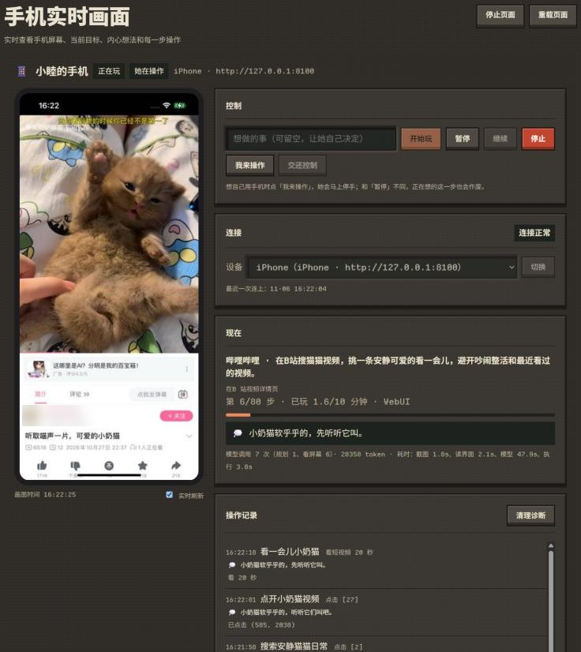

<div align="center">


# 刷会儿手机

   

让 Bot 用一台安卓手机、模拟器或 iPhone 自己刷视频、逛帖子、听歌、看小说：按人设和心情挑内容，像真人一样看屏幕、点击、滑动、搜索

</div>

- **自己玩手机**：她决定打开哪个应用、想看什么，看着屏幕一步步操作；短视频不喜欢就划走，长视频一段一段看，看过的不再点开
- **聊天里就能叫她**：「去刷会儿B站」「给我看看你在看什么」「别玩了」，不用记命令；也可以和她在手机上一起玩游戏
- **WebUI 实时画面**：看她的屏幕、此刻的想法和每一步操作，随时暂停、叫停，或者点「我来操作」接管手机
- **桌宠上也能看**：MaiBot 内置桌宠的扩展菜单里有个「手机」按钮，按钮上的字跟着她的状态变，点开就是截图、她的想法和开始、停止；玩的时候桌宠还会冒出她的想法
- **安卓和 iPhone**：模拟器、真机、无线调试、iPhone（WebDriverAgent）都行，多台手机换着用；锁屏会自动解开，玩完自己锁上
- **记得看过什么**：小说读到哪、听过的歌、你说过的喜好、上次没做完的事，下次接着来
- **和麦生活联动**：按日程自动玩，上班偶尔摸鱼，玩完把刷到的东西交给麦生活找机会私聊分享
- **代码兜底的安全边界**：白名单应用、每日额度、模型调用预算、卡住检测，都不靠模型自觉

> [!WARNING]
> 请用闲置手机和专门注册的账号。哪些限制靠代码保证、哪些只能靠提示词，见[安全边界](docs/safety.md)。

## 🩷 问题反馈&功能建议

| 方式 | 联系 |
| :--: | :--: |
| Github Issue | [跳转](https://github.com/hatsuhoq/maibot-phone-play/issues) |

## ✨ WebUI 预览



## 目录

[安装](#安装) · [开始使用](#开始使用) · [怎么让她玩](#怎么让她玩) · [聊天命令](#聊天命令) · [常用配置](#常用配置) · [常见问题](#常见问题) · [完整文档](#完整文档)

## 安装

**环境要求：**<br>
**MaiBot** `1.4.0–1.4.99`（1.3 请用插件 0.2.2）<br>
**SDK** `2.21.0–2.22.99`<br>
**Python** `≥3.12`<br>
**一台给她用的手机**：安卓（模拟器或真机，用 adb 控制）或 iPhone（用 WebDriverAgent 控制）

在 MaiBot 目录执行：

```bash
cd plugins
git clone https://github.com/hatsuhoq/maibot-phone-play.git phone_play
```

重新加载插件或重启 MaiBot，在 WebUI「插件扩展」里打开**刷会儿手机**。插件用到的 httpx、Pillow 是 MaiBot 本身的依赖，不用另装。

更新时在插件目录执行 `git pull`。`config.toml` 不在版本库里，更新不会覆盖你的配置。

## 开始使用

1. **准备手机** 按[安卓](docs/android.md)或 [iPhone](docs/iphone.md) 的说明连好。安卓 `adb devices` 能看到手机，iPhone 浏览器打开 `http://127.0.0.1:8100/status` 显示 `ready` 就行
2. **填设备** 打开 WebUI「插件扩展 → 刷会儿手机」的配置页，「设备」里安卓选 `adb`（必要时填 `adb_path`、`serial`），iPhone 选 `ios_wda`
3. **选视觉模型** 「模型」里 `vision_task`（默认 `vlm`）用的模型必须能看图，点得准不准基本取决于它。实测推荐 `gpt-6.1-terra`，可以用 `vision_model` 直接指定，只影响本插件
4. **整理白名单** 「安全」里的 `allowed_apps` 是她能打开的应用，默认是 B 站、抖音、小红书、网易云音乐、番茄小说的安卓包名，iPhone 要换成 Bundle ID。每个应用先在手机上手动打开一遍，处理掉首次启动的弹窗
5. **设管理员** 「插件」里的 `admin_user_ids` 填你的账号 ID（例如 QQ 号）。不知道的话先发 `/手机 开始`，没权限时回复里会附上你的账号 ID
6. **试一下** 私聊发 `/手机截图`，应收到手机画面；再发 `/手机 开始 刷B站看猫猫`，打开 WebUI 侧边栏「插件扩展 → 手机实时画面」看她一步步操作，发 `/手机 停止` 让她停下
7. **（可选）让她自己玩** 打开「自动玩」的 `enabled`，她会在空闲时按概率自己去玩；装了[麦生活](docs/mai-life.md)会按她的日程来

第一次建议盯着 WebUI 看几步，确认模型点得准。更完整的检查步骤见[联调](docs/development.md#联调)。

## 怎么让她玩

| 方式 | 怎么做 | 说明 |
|---|---|---|
| 直接跟她说 | 「去玩会儿手机吧」「你在看什么？给我看看」「别玩了」 | 她自己决定做不做、怎么回；通过聊天开始的，玩完会回来提一句 |
| 聊天命令 | `/手机 开始 刷B站看猫猫` | 精确控制，只有管理员能用 |
| WebUI | 「手机实时画面」里填想做的事，点「开始玩」 | 能登录 WebUI 就能用 |
| 桌宠 | 桌宠「插件扩展」菜单 →「手机」→「开始玩」 | 在跑 MaiBot 的电脑上用 |
| 她自己 | 打开 `auto_play.enabled` | 空闲时按概率；装了麦生活按日程，上班偶尔摸鱼 |
| 一起玩 | 「来手机上一起玩 xx」「来斗地主 2v2，我拉你」 | 同一台手机轮流玩，或各用各的手机联机 |

[使用指南](docs/usage.md)里有每种方式的细节，以及看视频、人工接管、内容记忆、用她自己的账号互动。

## 聊天命令

```text
/手机                     查看状态
/手机截图                 发送当前手机画面
/手机 开始 刷B站看猫猫     去玩手机；不写想做的事就她自己决定
/手机 暂停 · 继续 · 停止
/手机 接管 · 交还          你自己用手机 / 用完交还给她
/手机 设备 · 切换 OPPO     看有哪些设备 / 换一台
/手机 帮助
```

`/手机`、`/手机 设备`、`/手机 帮助` 所有人都能用，其他只有管理员能用（`/手机截图` 可以用 `plugin.screenshot_for_everyone` 放开）。[完整命令说明](docs/usage.md#聊天命令)。

## 常用配置

都在 WebUI「插件扩展 → 刷会儿手机」的配置页里改，保存后立即生效。[全部配置](docs/configuration.md)。

| 配置 | 默认值 | 说明 |
|---|---|---|
| `device.backend` | `adb` | `adb`=安卓，`ios_wda`=iPhone |
| `device.serial` | 空 | 安卓设备序列号或 `IP:端口`；无线调试只填 IP 也行 |
| `model.vision_model` | 空 | 看屏幕用的模型，空着就用 `vlm` 任务的模型 |
| `safety.allowed_apps` | 5 个常用应用 | 白名单；每个应用还能单独设时长、步间隔、玩完回不回桌面 |
| `play.extra_persona` | 空 | 她的兴趣爱好，决定她搜什么、看什么、划走什么 |
| `play.max_session_minutes` / `daily_session_limit` | 15 / 8 | 一次最多玩几分钟、每天最多玩几次 |
| `play.daily_model_call_limit` | 1000 | 每天最多调用几次模型，用来控制花费 |
| `play.lock_after` | 开 | 玩完锁屏，下次玩时自动解开；手机设了锁屏密码就关掉 |
| `interaction.enabled` | 关 | 用手机上登录的账号点赞、评论、关注 |
| `auto_play.enabled` | 关 | 空闲时自己决定要不要玩 |

**花费参考**：每一步是一次带截图的视觉模型调用。实测 gpt-6.1-terra 每步约 5 秒、约 3700 tokens，玩 10 分钟大约 35～40 步、十三四万 tokens。

## 常见问题

- **开始不了，WebUI「连接」显示「配置有问题」或「要在手机上点允许」**：这类重试没用，插件会马上说明原因，不占每天的次数。常见的是 adb 路径不对、包名格式不对、连着好几台安卓设备却没填 `device.serial`；「要点允许」是安卓上没点「允许 USB 调试」。
- **iPhone「连不上 WebDriverAgent」**：多半是 `ios runwda` 或端口转发退出了，或者免费签名过了 7 天，见 [iPhone 常见问题](docs/iphone.md#常见问题)。
- **「锁着屏，自动解锁没成功」**：多半是设了锁屏密码。去掉密码（安卓改成「无」或「滑动」）她就能自己解开；不想去掉就关掉 `play.lock_after`，并把自动锁定改成「永不」。插件不会替你输密码。
- **WebUI 里的画面是黑的**：玩完锁屏了，空闲时看画面不会解锁，下次玩时会自动解开。
- **WebUI 显示「插件 WebUI 已下线」**：插件刚被重新加载（修改了插件文件或配置），等几秒后点右上角的「重载页面」。插件重新加载会结束正在进行的那次。
- **想让她玩新装的应用**：在 `safety.allowed_apps` 里加一项，写上包名（安卓用 `adb shell pm list packages -3` 查，iPhone 用 `ios apps` 查）、名称和备注；备注会告诉她这个应用能玩什么、怎么用。
- **搜索中文失败**：安卓要装 ADBKeyboard；不装就把 `device.text_input` 设为 `ascii_only`，插件会提前告诉她只能用英文搜索。
- **结束原因写「卡住了：…」**：在操作记录里点「查看当时的画面」，看她要点的位置对不对。常见是点了没反应的按钮（广告、灰掉的按钮），或者两个页面来回跳；可以在应用备注里写明这个页面该怎么走。
- **操作记录里写「看不出现在在哪个应用，先不操作」**：一般是手机短暂卡顿，下一步认出来就接着玩；连续几步都这样会按连续出错结束。有的设备一直给不出前台应用，插件会在操作记录里说一声，照常玩，但这时没法按白名单把她拉回桌面。
- **连续出错结束**：看操作记录里失败那几步的原因；模型输出格式错误时，换一个更擅长遵循格式的视觉模型。

安卓、iPhone 各自的问题见[准备安卓手机](docs/android.md#常见问题)和[准备 iPhone](docs/iphone.md#常见问题)。

## 完整文档

- **准备手机**：[安卓](docs/android.md) · [iPhone](docs/iphone.md)
- **使用**：[使用指南](docs/usage.md) · [多台设备、锁屏和解锁](docs/devices.md) · [和麦生活联动](docs/mai-life.md)
- **配置**：[配置说明](docs/configuration.md) · [安全边界](docs/safety.md)
- **开发**：[工作原理、已知限制与测试](docs/development.md) · [更新日志](changelog.md)

许可证：[GPL-3.0-or-later](LICENSE)
