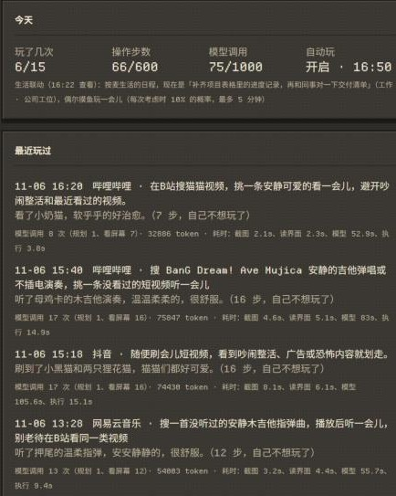

# 使用指南

[← 返回 README](../README.md)

[直接跟她说](#直接跟她说) · [一起玩](#一起玩) · [聊天命令](#聊天命令) · [周报](#周报) · [自动玩](#自动玩) · [看视频](#看视频) · [人工接管](#人工接管) · [内容记忆](#内容记忆) · [WebUI 实时画面](#webui-实时画面) · [桌宠](#桌宠) · [互动](#互动)

## 直接跟她说

不用记命令，像平时聊天一样说就行。她会结合上下文理解你的意思，自己决定要不要做、怎么回：

| 你说 | 她会 | 用到的工具 |
|---|---|---|
| 「去玩会儿手机吧」「帮我刷刷B站看看有没有睦睦的视频」 | 拿起手机，定好玩什么后顺口告诉你打算 | `play_phone` |
| 「你在看什么？给我看看」 | 截一张手机屏幕附在回复里发给你，边看边聊 | `show_phone_screen` |
| 「刚才在手机上看了啥？」 | 聊聊正在看或刚才看过的内容 | `phone_activity` |
| 「别玩了，过来陪我聊天」 | 放下手机接着聊 | `stop_phone` |
| 「换安卓手机玩」（管理员说） | 换一台手机，见[多台设备](devices.md#多台设备) | `switch_phone` |
| 「来手机上一起玩 xx」 | 打开双人游戏和你一起玩，见[一起玩](#一起玩) | `play_phone` 的 `together` |
| 「我喜欢看种田小说」「下次接着看那本」 | 记下来，下次挑内容时参考，见[内容记忆](#内容记忆) | `remember_for_phone` |
| 「这个视频你有空看看」「回头听听这首」「那个不用看了」 | 记进「有空要看」，之后玩手机时去找来看，看完了能接着聊，见[有空要看](#有空要看) | `remember_for_phone` 的 `later`、`cancel` |

- **玩完会提一句**：通过聊天开始的那次，玩完后她会回到那个聊天，用自己的语气随口提两句看到的东西，也可能不说（`play.finish_notice`，可改为固定通知 `template` 或关闭 `off`）。
- **刷到好东西会给你看**：每局里她最喜欢的那一下，玩完先把截图发到叫她玩的聊天，再顺口说一句「你看这个」（`play.share_moments`，默认开）。哪一下算最喜欢：她自己标了「这一刻」的以她标的为准；没标的话，就是她连着看同一个视频看得最久的那段（至少 30 秒），用那段最后看到的画面和她当时的想法（黑场、还在加载的黑播放器不算，取前面那张能看的；整段只截到黑场就不挑）。她自己标的那一下要是正好截到黑屏，只记她当时在想什么，不发截图。连着看满一分钟时桌宠开心一下（一段一次，同一局里至少隔一分钟）。截图里可能有通知，所以只在叫她玩的人本来就能看她手机截图时才发（`admin_user_ids` 里的人、开了 `plugin.screenshot_for_everyone`；`/手机 开始` 能用就算）；自动玩、WebUI 和桌宠上开始的没有发起的聊天，只有桌宠开心一下。`play.finish_notice` 是 `off` 时也不发。
- **玩不成会说原因**：手机没开机或连不上、今天玩够次数了、想做的事手机上的应用做不到（比如想玩的游戏没加进白名单）。这几种情况不占每天的次数，也不会再额外发结束通知；技术细节（adb 报错等）只显示在 WebUI 和 `/手机` 状态的「最近的错误」里。
- **看屏幕默认只有管理员可以**：别人让她看时她会婉拒；开启 `plugin.screenshot_for_everyone` 后所有人都可以。聊天里是按宿主传来的发言人账号判断的，模型理论上能改写这个参数，所以只算辅助限制；`/手机截图` 命令的权限不受影响。
- **谁都能叫她去玩**：次数受每日额度限制；不想让她在聊天中去玩就关闭 `play.allow_chat_trigger`。
- 她回不回、什么时候回，还受 MaiBot 自身的回复频率设置影响；私聊消息少时可能会延迟处理。
- `play_phone`、`phone_activity`、`stop_phone` 一直放在她的工具列表里（叫她去玩、问她在看什么时能马上反应），每次思考会多带几百 token 的工具说明；`show_phone_screen`、`switch_phone`、`remember_for_phone` 不常用，仍是需要时再搜索。

**手机上的她和聊天里的她**：手机是插件里另一个「她」在一步步操作，聊天里的她看不到画面。玩手机期间，发起的那个聊天每一轮都会带上手机上的实际情况（在玩什么、最近几步、想法），她聊手机上的事以这个为准；你在聊天里让她做什么（点准备、退出房间、接受邀请），她会用 `play_phone` 转给手机上的她，下一步优先照做；你叫她别玩了，她会用 `stop_phone` 放下手机。

**你交代的事有始有终**：每件事都有状态，聊天里的她、WebUI「现在」、桌宠面板看到的是同一份：

- **等着做 → 在做 → 做到了 / 做不到**：手机上的她要在截图上真看到结果（歌在播放、已经退出房间）才算做到了，只是点了一下、页面还在加载都不算；确定做不到时写明原因（找不到这首歌、按钮点不了）。在那之前，聊天里的她只会说「正在弄」。
- **做到了或做不到会回来说一声**：回到交代这件事的聊天，用她自己的语气说结果（`play.report_requests`，默认开；说法跟着 `play.finish_notice`，它是 `off` 时也不说）。放下手机那一步才有结果的，不单独说，和玩完那句一起说，免得接连冒两段话。
- **改主意了**：你说「别弄那个了，改成……」时，她会把之前没做完的标成「换成了新要求」，之后晚到的结果不算数；只是再加一件事就排在后面。
- **没做完就放下手机**的会记成「没做完就放下了手机」，玩完那句话里会照实提，不会让你以为做好了。
- **同一件事不重复交**：还没做完的事里已经有一样的（去掉标点后一样，或者够长时一个包含另一个），再交代一遍不会多一条，她会知道这件正在做。
- **只收拿起手机那个聊天的**：交代的事做完要回到那个聊天说，所以在别的聊天（比如群里）叫她做事，她只知道自己正在手机上玩什么、腾不出手，会照常说一句在玩、晚点再说，不会提另一个聊天里的事；聊天里想看画面用截图（`show_phone_screen`），不用交给手机上的她。

## 一起玩

先把游戏加进 `safety.allowed_apps`，备注里写清楚怎么玩。两种方式：

| | 同一台手机上轮流玩 | 各用各的手机联机 |
|---|---|---|
| 适合 | 双人对战这类 | 好友房、组队，比如欢乐斗地主 2v2 |
| 怎么说 | 「来手机上一起玩 xx」 | 「来斗地主 2v2，我拉你」 |
| 她怎么做 | 轮到你时用 `wait_turn` 等你，你在手机（或模拟器窗口）上操作 | 进你说的房间、接受邀请，和你一起开局 |
| 等待时 | 每 1.5 秒截图比对、**不调用模型**，画面变了才轮到她；超过 `play.turn_wait_seconds`（默认 180 秒）没等到，她自己决定接着等还是结束 | 在房间里一次等 60～120 秒，每 3 秒截图比对、**不调用模型**；有人进来、开局了或聊天里有新要求就提前醒来 |

- 一起玩最多 `play.together_minutes`（默认 30 分钟）。
- 联机游戏建议在应用里加上 `reopen_on_start = "no"` 和 `go_home_after = "no"`：下次打开不先关掉，接着上次的房间、不用重新加载；玩完不回桌面（回桌面会退出房间）。见[每个应用单独设置](configuration.md#每个应用单独设置)。
- 一起玩时本来就不会先关掉应用；其他应用在上次结束后 15 分钟内再打开，也会接着上次的画面。

## 聊天命令

| 命令 | 说明 | 权限 |
|---|---|---|
| `/手机` | 查看状态、今天玩了几次 | 所有人 |
| `/手机截图` | 发送当前手机画面 | `admin_user_ids` 里的人；开启 `plugin.screenshot_for_everyone` 后所有人 |
| `/手机 开始 [想做的事]` | 去玩手机，例如 `/手机 开始 刷B站看猫猫`；不写则她自己决定。回复里会说她打算打开哪个应用，开始不了时说明原因 | 有命令权限的人 |
| `/手机 暂停` / `/手机 继续` / `/手机 停止` | 控制当前这次 | 有命令权限的人 |
| `/手机 接管` / `/手机 交还` | 你自己用手机 / 用完交还给她，见[人工接管](#人工接管) | 有命令权限的人 |
| `/手机 设备` | 有哪些设备、现在用哪台 | 所有人 |
| `/手机 切换 名字` | 换一台手机，例如 `/手机 切换 OPPO`；正在玩时不能换 | 有命令权限的人 |
| `/手机 周报` | 最近 7 天的使用周报，发一张图，见[周报](#周报) | 所有人 |
| `/手机 帮助` | 查看命令 | 所有人 |

- **命令权限由 MaiBot 管**：开始、停止、暂停、继续、接管、交还、切换是 MaiBot 的受保护命令 `phone_control`。MaiBot 的插件管理员（MaiBot 配置里的 `plugin.permission`）和本地控制台直接能用；其他人在 MaiBot 后台「命令管理」里选中 `phone_control`，按人或按聊天放行。没权限时 MaiBot 回「你没有权限使用此命令。」，开了「不显示无权限提示」就什么也不回。
- **`plugin.admin_user_ids` 只管截图和换手机**：`/手机截图`、在聊天里让她截图给自己看、让她换一台手机（填账号 ID，例如 QQ 号；本地控制台始终算）。截图没权限时，回复里会附上发送者的账号 ID，方便复制到配置里。
- **屏幕关着时不发黑图**：截出来几乎全黑、手机屏幕也确实关着或锁着（她没玩时手机多半锁着），`/手机截图` 会回「没发截图：手机屏幕关着（锁屏或者熄屏了），截出来是黑的」，聊天里让她截图给你看时她会照实说屏幕黑着，不发那张黑图；屏幕亮着、只是画面暗（视频黑场、深色页面）的照常发。截图不会为此点亮或解锁手机。
- 用命令开始的那次，结束后会在原聊天里说一声玩了什么。
- WebUI 页面上的按钮不受这些限制，能登录 WebUI 就能控制。

### 周报

`/手机 周报` 把最近 7 天（含今天）做成一张图发出来：

- 拿起手机几次、一共玩了多久、平均每天多久，每天各玩了几分钟。
- 玩得最久的 5 个应用，以及这些局是怎么开始的（自己想玩、桌宠、聊天里叫她……）。
- 这几天看过的视频、在看的小说、在听的歌，来自[内容记忆](#内容记忆)，看得久的在前。
- 她最近几次玩完的感想。

图由 MaiBot 的浏览器渲染生成，MaiBot 配置里「浏览器渲染」的「启用浏览器渲染」要开着（默认开）。电脑上有 Chrome 或 Edge 就直接用，没有时 MaiBot 会自动下载 Chromium。

每天玩了多久按每次的记录算，存在使用记录里，留最近 35 天；从 0.3.0 升级上来时，用还留着的最近 30 次记录补上，之前的不算。

## 自动玩

- **聊天中**：她自己无聊了也可能主动去玩（同样是 `play_phone`）。
- **空闲时**：开启 `auto_play.enabled` 后，每隔 `check_interval_minutes` 分钟，在 `active_hours` 时间段内按 `play_probability` 的概率自己去玩。装了麦生活（Mai_life）时按她的日程决定，上班时还会偶尔摸鱼，见[和麦生活联动](mai-life.md)。
- **手机连不上时会告诉你**：自动玩决定要去玩之后，先看看手机连不连得上（和玩到一半断开一样最多等 45 秒，不解锁）。连不上这次就不玩，也不调用模型；桌宠冒一句「📵 手机连不上了，能帮我看看吗？」，再去你（`admin_user_ids` 里的第一个）和她的私聊里用自己的语气说一声（说法跟着 `play.finish_notice`：`template` 时带上连不上的原因，`off` 或没和她私聊过时只冒桌宠气泡）。一次断开只说一次，连上以后桌宠说「📱 手机连上啦」，之后再断开会再说。
- **玩什么、看什么**：按 MaiBot 里的人设，加上 `play.extra_persona` 里写的兴趣爱好来定。
  - 没说要做什么时，她会想一个具体想看、想听的东西去搜。实测写了「喜欢吉他、种黄瓜、MyGO!!!!!」后，她会自己去网易云搜《栞》、在小红书搜阳台种黄瓜。
  - 刷到不感兴趣的，短视频直接划走，长视频、笔记、文章返回列表换一个。
  - 人设里只写了性格、没写爱好时，挑内容会比较泛，建议在 `extra_persona` 里写几样她喜欢和不喜欢的。

### 电量

插件会看手机电量：开始玩时看一次，玩的时候每 5 分钟看一次，自动玩决定要去玩之后、拿起手机之前也看一次。看电量不点亮屏幕、不解锁；安卓读 `dumpsys battery`，iPhone 读 WebDriverAgent 的电池信息。

- **快没电又没插电时**（低于 `play.low_battery_percent`，默认 20%）：她不会自己去玩，聊天里叫她会说「手机快没电了，先充会儿电再玩」（不算一次）；正在玩的到点放下，结束原因写「手机快没电了（剩 15%），先放下充会儿电」。空闲时你问起，她也知道手机快没电了。
- **她想玩时没电，会请你帮忙充电**（`auto_play.ask_to_charge`，默认开）：自动玩决定要去玩、却发现手机快没电又没插电时，桌宠冒一句「🔌 手机快没电了（剩 12%），能帮我充一下电吗？」，再去你（`admin_user_ids` 里的第一个）和她的私聊里用自己的语气问一句（说法跟着 `play.finish_notice`，它是 `off` 时只冒桌宠气泡；没和她私聊过时也只冒桌宠气泡）。一次没电只问一次，看到插上电、或者电量回到阈值以上才重新算；插上电以后桌宠会说「🔌 充上电啦，谢谢～」，下次想玩时照常去玩。只在本来就允许她自动玩的时间里才会问（`active_hours` 或麦生活的日程），睡觉的时候不会。
- **你明确要她玩的不拦**：`/手机 开始`、WebUI「开始玩」、桌宠上开始的照常玩。设成 0 就完全不管电量。
- **只在充电时自动玩**：打开 `auto_play.only_when_charging`，手机没插电时就不自动玩，适合一直插着电的闲置手机。
- 读不到电量的手机（模拟器、这次没连上）当作不知道，照常玩，不当成 0%。WebUI 顶上、`/手机` 状态和桌宠面板会显示最近一次看到的电量、是否在充电和看的时间。

### 自己想装游戏（默认关）

打开 `auto_play.game_wishes` 后，她自己想玩时偶尔会想装一款手机上没装的游戏，先问你，你同意了她自己去应用商店装。

- **只在她自己想玩时问**：自动玩决定去玩、规划玩什么时，可以不选白名单里的应用，说想装哪款、为什么想玩。聊天里叫她玩、`/手机 开始`、WebUI 和桌宠上开始的都是有人等着她玩，不问；上班摸鱼的那几分钟也不问。规划时会提醒她挑节奏慢、回合制或竖屏的（打牌、下棋、消除、模拟经营），实时动作、塔防她跟不上。
- **怎么问**：这次就不玩了。桌宠冒一句「🎮 想玩《某游戏》，能帮我装一下吗？」，再去你（`admin_user_ids` 里的第一个）和她的私聊里用自己的语气问（说法跟着 `play.finish_notice`；`template` 时发「回我「可以」或「不装」就好」，`off` 或没和她私聊过时只冒桌宠气泡）。
- **怎么回答**：在那个私聊里直接说「可以」「装吧」或「不装」就行，她每一轮都知道自己在等这个回答，会用 `answer_game_wish` 记下；只认管理员的回答。也可以在 WebUI「手机实时画面」的「她想装的游戏」里点「同意，去装」或「不装」。`/手机` 状态里会写着她在等你回。
- **多久问一次**：同一时间只有一款在问或在装；一天最多问一次；你说不装的那款 30 天内不再问；一天没回就算了。
- **同意后**：她马上拿起手机，这局只能打开应用商店（iPhone 是 App Store；安卓按顺序找 OPPO / 一加的软件商店、小米、华为、vivo 自带的商店），找这一款、确认免费再装，最多 15 分钟。
  - **只装免费的**：按钮写着价格（¥…、$…）、「购买」「订阅」「支付」「充值」「Buy」「Subscribe」的，插件直接不让点；App Store 会把说明并在按钮文字后面（免费的是「Get, In-App Purchases」），只看逗号前那段，整张搜索结果卡片上带着价格的照样能点开看。要付费她就不装了。带「App 内购买」的免费游戏照样装，只是不买东西。
  - **不点广告**：搜索结果里标着「广告」「Ad」的那条（App Store 搜索时常排在第一条，名字和要找的很像），插件不让点，包括广告卡片里的「Get」按钮。
  - **要输密码、双击侧边按钮确认时会停下来请你帮忙**（iPhone 用面容 ID 买东西时要连按两次侧边按钮，插件按不了）：你在手机上弄好再交还，见[人工接管](#人工接管)。她自己不输账号、密码、验证码。
  - **怎么算装好**：装好后她在商店里点「打开」，插件看到前台换成了新应用就算装好（安卓还会和装之前的应用列表比；iPhone 查不到装了哪些应用，系统自带的应用不算）。这局到这里结束，她回那个私聊说一声装好了；没装上会照实说原因。装游戏这局不记成「没做完的事」，下次她不会想回商店接着装。
- **装好以后**：游戏记在插件数据目录的 `games.json`，只在装它的那台手机上能玩，规划时和白名单里的应用一起给她挑（写着「你自己装的游戏」）；白名单里本来就有的以白名单为准。不改你的配置文件。WebUI 里点「不让她玩了」就不再打开它；插件不卸载应用，要删请自己在手机上删。
- **真机验证到哪一步**：2026 年 11 月在 iPhone 上真机装过一款免费数独游戏（App Store 是英文界面）：搜索、跳过排在第一条的广告、点 Get、在弹出的确认页点「安装」、等下载、点「打开」，8 步、1 分半装好，她在私聊里说了装好了，游戏记进了 `games.json`。那次是手动记了一条想装的游戏、在 WebUI 里点的同意，她自己想装、去私聊问你这一段只有单元测试；那台手机装免费应用没要面容 ID 或密码（和 Apple ID 的设置有关），要的时候停下来请你帮忙这一段也只有单元测试。安卓的商店包名没有真机试过。

## 看视频

短视频和长视频分开看，她每次「看一会儿」都要说明在看哪种：

| | 短视频（竖屏、一两分钟以内） | 长视频（横屏、几分钟以上） |
|---|---|---|
| 不感兴趣 | 一眼看出来就上滑，不等 | 先看 20～30 秒判断，不喜欢就上滑或返回换一个 |
| 感兴趣 | 一次看 10～40 秒（最多 60 秒）看完，再上滑下一条 | 一次看 60～120 秒，一段一段接着看；十几分钟以上的看够几分钟可以换 |
| 等待期间 | 不调用模型；中途截几张留给下一步，见[看完一段说得出看到了什么](#看完一段说得出看到了什么) | 同左 |

看视频时画面一直在变，所以不按画面变化叫醒她，看满她定的时间才问下一步；聊天里有新要求、被叫停或接管时马上醒来，每 5 秒看一眼前台，点到广告跳去别的应用也会提前醒来。操作记录里写的是「看短视频 20 秒」「看长视频 90 秒」，每一步也会告诉她正在看的视频已经看了多久。

### 看完一段说得出看到了什么

`play.video_keyframes`（默认 4，0 关掉）。以前她看完一段只看得到最后一张截图，说起这段只能凭最后那一下。现在：

- **看的时候**：插件每隔至少 10 秒截一张（看 20 秒截 2 张，看 50 秒以上截 4 张），只截图、不调用模型，每张约 0.3 秒。点到广告跳去别的应用、被叫醒时就不再截。
- **下一步**：只裁出视频那块（几张里多数时候都在变的那几行，状态栏时钟、轮播广告不算）、缩到 512 像素，连同现在的整个屏幕一起给她看。她用一两句话写下这段画面和字幕上真有的内容，不写感受，写进操作记录的「这段视频看到的」。下一步的操作记录也带着这句话，她接着看时知道前面看到哪了。
- **不编**：没有字幕就是不知道说了什么，别编对白和情节；弹幕是观众的评论，标题、封面都不算看到的内容；只截到几张，中间没截到的别猜。插件听不到声音。
- **不串**：写下的记在截图时在看的那个视频名下，她这一步划到下一个也不会记错；换了视频、做了别的操作，没给她看的截图就作废。暂停、黑场时几张都一样，认不出视频在哪，就不给她看，她这时写的也不记。
- **用在哪**：玩完的记录最多留 4 条。她放下手机后在聊天里提起这次（会叫她只按这些说），聊天里问她在看什么、刚才看了什么，以及交给麦生活分享时都会用上。
- **花多少**：每次决定多约 1000 个输入 token（约 26%），不多调用模型，算在原来的调用和 token 统计里。
- **怎么验证的**：2026 年 11 月在 iPhone 的 B 站上截下三个视频（做菜教程、讲课、没有台词的延时摄影）各 90 秒的画面，每 3 秒一张当参照，离线用同一个视觉模型对比。这不是她自己玩时自然发生的。结果：
  - 只给她看中途画面、不让她写时，她的想法照旧只说眼前这一下；让她写下来时，每段能记下三四个真有的要点。
  - 18 次里没编过对白，延时摄影也没写出解说。
  - 两次截图之间的内容会漏掉（比如开头讲的一个笑话）。
  - 截 8 张能多记一点，但输入多约 49%，所以默认 4 张。
  - 只给最后一张时，有一次她把还在播的做菜视频当成看完了，给了中途画面的几次没有。
- **真机上自然跑的一局**（2026 年 11 月 26 日，聊天里叫她去 B 站找做饭视频，5 分钟，看了三段）：
  - 三段都写下了画面和字幕上的内容（拍黄瓜、往蒜泥里倒生抽香醋；削皮切斜片、字幕说选鲜嫩的黄瓜；番茄青椒下锅、字幕说大火翻炒半分钟），都标明了是画面还是字幕。没有逐帧核对对不对。
  - 她从中途画面看到第一个视频在用削皮刀，觉得是带货，就换了一个。
  - 放下手机后在私聊里只说了一句看了个黄瓜炒番茄的视频，挺清爽，没提细节。
  - 这局平均每次调用输入 5822 token（之前两局 B 站是 5558、5648），截图多花约 3 秒。

横屏（全屏视频、横屏游戏）也能玩：截图是横着的，她按横着的画面找位置。她想的这几秒里屏幕转了方向（点了全屏、游戏开局），这一步不点也不滑，按新画面重新看；WebUI 实时画面在横屏时占满一行。

### B 站的两种视频页

适用于 `tv.danmaku.bili`、`tv.danmaku.bilianime`、`com.bilibili.inter`、`tv.danmaku.bilibilihd`。同一个视频从不同入口点开，页面和操作都不一样，插件每一步按界面元素认出是哪种页面，只告诉她这一种页面怎么看：

| | 竖屏播放器 | 视频详情页 |
|---|---|---|
| 从哪点开 | 首页推荐 | 搜索结果、相关推荐、UP 主主页 |
| 样子 | 整屏一个视频，竖着占满的是短视频，横着上下黑边的是长视频 | 上面播放器，下面「简介」「评论」两个标签 |
| 上滑 | 换下一个推荐视频（长视频也一样） | 只翻简介、评论和相关推荐，视频不换、接着播 |
| 换一个视频 | 上滑 | 返回搜索结果点下一个，或点相关推荐 |
| 标题 | iPhone 上插件读不到，要她写下来；安卓上插件读得到 | 插件从界面元素里读 |

插件怎么认出这两种页面

- **竖屏播放器**：iPhone 上标题、UP 主、关注那几个元素的文字是占位名（`title`、`name`、`fans`、`follow`），或者整屏一格加「多少人正在看」；安卓上有「详情页」按钮加「多少人正在看」。
- **视频详情页**：同时有「简介」和「评论」。
- 每次滑动后也会按页面告诉她结果：详情页里是「只是在翻简介和评论，视频没换」，竖屏播放器里是「换到了下一个推荐视频」；详情页里翻评论、切简介和评论不算换视频，看了多久接着算。
- 认不出（首页、搜索结果、读不到界面元素）时给一段总的说明：首页点开进竖屏播放器，搜索点开进详情页，卡片上标着「最近看过」的是看过的。
- WebUI「现在」里会显示认出来的页面。长视频她可以点全屏看，手机转成横屏后截图和点的位置都跟着转；全屏时上下滑是调亮度音量、左右滑是拖进度，要换视频、看评论先点画面调出按钮，再点左上角的返回退出全屏（iPhone 上返回手势在全屏时没用）。
- 以上是 2026 年 11 月在 iPhone 和 MuMu 安卓模拟器上的 B 站实测的样子，B 站改版后可能要跟着改。

### 网易云音乐和番茄小说

这两个应用里，插件认得出下面两种页面，每一步把手机上实际的状态告诉她，「放某首歌」「翻到下一页」做没做到看这一行，不用她猜：

- **网易云播放页**（点开的播放页，和首页「心动」那种整屏播放）：在放哪首（歌名,歌手）、正在播放还是暂停着、放到哪了（比如 02:58/03:43）。会员广告盖住播放页时（「立即开通」「立即续费」「开会员无限畅听」这类），会提醒她按钮点不到，先点广告右上角的 × 关掉，别点开通、续费。只有底下一条迷你播放条的页面不算播放页。
- **番茄小说阅读页**：现在是哪一章、右下角的页码（翻过去就会变）、点画面中间调出的菜单（上一章、下一章、目录）开着没有。书架、阅读历史上也写着「第1章 ……」，但没有页码，不会认成阅读页。

另外会提醒她这两个应用常弹会员广告、优惠券、开启通知的框，点 × 关掉，别点开通、续费、「开心收下」，也别去开启通知。只在 2026 年 11 月的 iPhone 上验证过；没见过加载中的样子，所以不认加载中。

### 看过的视频不再看

`play.skip_watched_videos`，默认开。她看视频时会写下画面上的标题，插件记下哪个应用里看过哪些、看到哪了，保存 30 天、最多 300 个：

- **看到哪一步**：只点开过、看了一部分、看完了，另外单独记「不感兴趣」。看完了要有画面上的依据（出现重播按钮、进度条到头），只按看了多久不算；看了多久按她实际停在视频上的时间算，被新要求、叫停、接管提前叫醒前的那一段也算进去（这是停留时间，不是播放进度）。
- **看了一部分的长视频可以接着看**：只点开过或看了一部分、也没说不感兴趣的长视频不拦，还会告诉她「上次只看了一部分，想看可以接着看」；聊天里问起她会说「那个看了一半」。短视频划走了就不再回去看。
- 0.3.1 及以前记下的视频只知道「看过」，照旧不再点开，不会被当成看完或看了一半。
- 每一步告诉她这个应用里最近看过、不打算再看的 30 个（每个标题只列前 30 个字），刷到了就划走。iPhone 上 B 站的详情页只告诉她画面上的那几个：推荐视频的标题都读得到，不在画面上的这一步也点不到，每步能少约 600 个 token。别的页面（竖屏播放器读不到标题）和安卓（没实测）还是说 30 个。
- **代码拦截**：在首页、搜索结果里点的视频卡片，卡片上的文字（B 站搜索结果的卡片自己的文字常是一条热评，卡片里单独那行标题也算）和看过的对上，或者 B 站自己在卡片上标着「最近看过」「已看完」，就不点；在播放器里刷到、标题对得上看过的，就不看，让她换下一个。这两种都不算出错。
- **对方点名要看的不拦**：聊天里的要求、这次的目标里写着这个标题时照常看。
- 比对时忽略【】《》、标点和空格；卡片文字会被截短，所以够长（8 个字以上）时一个包含另一个也算。歌名这样的短标题要完全一样才算，免得把同名的现场、翻唱都当成看过。盖住大半个屏幕的元素（播放器整屏那一格）不拿来比对。
- B 站详情页的标题插件自己读；竖屏播放器和别的应用里要靠她认出并写下标题，看不清时记不下来，也就拦不住。没有界面元素的画面里点卡片只能靠提示词。

## 人工接管

想亲自用这台手机时（帮她过一个卡住的弹窗、登录、看一眼别的东西），在 WebUI 点「我来操作」或发 `/手机 接管`：

- **她马上停手**：已经发给模型、还没回来的那一步回来后直接作废，不会在你操作时突然点下去；正在看视频、等对方的长等待也会立刻停下。
- **和「暂停」不同**：暂停是让她歇一会儿，接管是你要亲自用，所以她正在想的这一步也不做；接管期间也不会因为前台不在白名单而按回桌面。
- **空闲时也能接管**：这时自动玩不会开始，聊天里叫她玩、`/手机 开始` 也会被拒绝（会说明是你在用）。
- **用完交还**：点「交还控制」或发 `/手机 交还`。她会先重新看前台应用、截图和界面元素，按你操作后的画面重新决定，不会去做接管前想好的动作；如果你把手机停在了白名单以外的应用，她会先回桌面。
- 接管和暂停的时间不算进这次的游玩时长，但从开始算起超过「计划时长 + 30 分钟」还没交还，这次就结束；结束时如果还是你在操作，她不会按回桌面，也不锁屏。
- 连续点几次「我来操作」或「交还控制」只算一次；接管期间叫停、手机断开重连、这次结束都不会让她自己恢复操作。

### 她卡住时会找你帮忙

能关掉的弹窗、能换个内容看的，她自己处理。遇到关不掉、绕不开、必须有人处理才能接着玩的画面（要登录或重新登录、验证码或滑块验证、只能点允许的系统权限、强制更新），她会停下来请你帮忙，而不是反复乱点到被判定卡住：

- **她会说清楚要帮什么**：桌宠冒一句「🙋 帮我一下：小红书要重新登录才能看笔记」；从聊天开始的那次，还会回到那个聊天请你帮一下（说法跟着 `play.finish_notice`，它是 `off` 时不说），等你的时候那个聊天每一轮也会先提醒她手机上停着在等你帮忙。WebUI「现在」卡片和桌宠面板最上面也写着在等你帮什么，桌宠按钮上写「等你帮忙」。
- **怎么帮**：点「我来操作」或发 `/手机 接管`，在手机上弄好（输验证码、登录、点允许），再点「交还控制」或发 `/手机 交还`，她重新看画面接着玩。在聊天里跟她说了新的要求（「不用登录了，换个看」）也算处理完了，她照新要求来。
- **她绝不自己输账号、密码、验证码**；等你的时候也不再操作手机、不再求助第二遍。
- 等的这段不算进游玩时长；不在接管中的等待超过 `play.help_wait_minutes`（默认 5 分钟）就结束这次，结束原因写「等你帮忙等太久了」。

## 内容记忆

她会跨次记住一些和玩手机有关的事，下次决定玩什么时参考，比如「接着上次看」：

| 来源 | 记什么 | 怎么来的 |
|---|---|---|
| 画面上看到的 | 看的小说和章节、歌；看过的视频单独一类，见[看过的视频不再看](#看过的视频不再看) | 只有模型确认画面上清楚写着名字时才记；没把握的不记，画面上的其他文字也不会被当成谁的喜好 |
| 对方说过 | 对方亲口说的兴趣或要求 | 聊天里对方说「我喜欢看种田小说」「下次接着看那本」时，她用 `remember_for_phone` 记下 |
| 对方让你有空看的 | 对方让她有空、回头去看、去听的东西，见[有空要看](#有空要看) | 她用 `remember_for_phone` 的 `later` 记下 |
| 上次没做完 | 上一次的目标 | 时间到了、被叫停、被接管、卡住、出错时自动记下，她自己玩够了就清掉；3 天后不再提 |

- 规划时最多带 8 条，没做完的放最前，最后提看了一部分、可以接着看的长视频（最多 3 个）和最近看过的 5 个视频。看过的视频以外最多保存 60 条，超出时删最旧的。
- WebUI「她记得的」里能看到每条的来源，看过的视频还写着看到哪了（看了一部分、看完了、不感兴趣）；记错了可以单独删除或全部删除，看过的视频收在下面「看过的视频」里，可以单独清空。
- 数据存在插件数据目录的 `memory.json`；文件损坏时自动备份成 `memory.json.broken-时间` 并从空记忆开始。

### 有空要看

你在聊天里说「这个视频你有空看看」「回头听听这首」，她会记进「有空要看」：

- **不会马上拿起手机**：下次玩手机（聊天里叫她、自动玩都算）决定玩什么时，规划里会列出还没看完的（最多 3 个），她自己挑时间去看。
- **跟着她看到哪了更新**：手机上认出的标题和你说的名字对得上（去掉标点后一个包含另一个，至少 3 个字；记的话里带书名号时只拿书名号里的名字比对），停下来看了一会儿就是「看了一部分」，画面上看得出播完了才是「看完了」；在看、在听对方说的那本、那首，也算看了一部分。
- **看了会说**：那次玩完那句里会顺便提「你之前让我看的那个看完了」；空闲时聊天问起，她知道还有哪些没看。
- **不用看了**：跟她说「那个不用看了」，她会标成「不用看了」，之后不再去找；再说一次要看又会算上。WebUI「她记得的」里也能看到状态、单独删除。

## WebUI 实时画面

WebUI 侧边栏「插件扩展」→「手机实时画面」：约每秒刷新一次的屏幕画面、当前目标、她此刻的想法、每一步的操作记录，以及开始 / 暂停 / 继续 / 停止、我来操作 / 交还控制按钮。页面不在前台或取消勾选「实时刷新」时不会截图。画面和状态分开刷新：截图慢、卡住时状态（谁在操作、重连进度、按钮能不能点）照样每 2 秒更新，取消勾选「实时刷新」后状态也照常更新；页面切回前台、重新勾上时马上刷新。换了手机后不会再显示上一台的画面。

| 区域 | 内容 |
|---|---|
| 连接 | 连上了、重连中（第几次、还会再试多少秒）、要先解锁、要在手机上点允许、配置有问题、连不上，以及最近一次连上的时间、错误和该怎么处理；有多台设备时在这里切换 |
| 现在 | 当前在用的应用、从哪个应用开始、中途去过哪些、认出来的页面；这次的模型调用次数（规划、看屏幕、失败）、token（宿主没给就写「未提供」）、截图 / 读界面 / 模型 / 执行各花了多少秒 |
| 操作记录 | 每一步做了什么、她的想法和结果；失败的步骤可以「查看当时的画面」，图上标着她要点的位置或滑动方向。诊断最多留 30 条、3 天，「清理诊断」可以全部删掉 |

这里只显示这一局最近 60 条，插件重载后就清空了。每局完整的操作记录另外存在插件数据目录的 `session_logs` 里（一局一个 `.jsonl` 文件，按开始时间命名，第一行是这局怎么开始的，最后一行是怎么结束的），留最近 30 局，插件重载、MaiBot 重启后也翻得到；只有文字，不存截图。
| 今天 | 玩了几次、操作步数、模型调用次数和各自的上限、下次考虑自动玩的时间；开着生活联动时写着麦生活的日程和现在能不能自动玩 |
| 最近玩过 | 每次去过的应用和各待了多久、她的感想、调用统计 |
| 她想装的游戏 | 开了 `auto_play.game_wishes` 才显示：在等你回答的那款（「同意，去装」「不装」）、她自己装的游戏（「不让她玩了」）和问过的记录，见[自己想装游戏](#自己想装游戏默认关) |
| 她记得的 | 见[内容记忆](#内容记忆) |

> [!NOTE]
> 画面受 WebUI 单次查询 512 KiB 的限制，是压缩过的监控画面，不是视频流。想看流畅画面可以在电脑上另开 scrcpy。

## 桌宠

MaiBot 1.4 内置了桌宠。插件在桌宠上做了这些事，配置在「桌宠」里：

- **「手机」按钮**（`desktop_pet.button`，默认开）：在桌宠的拼图图标「插件扩展」菜单里。按钮上写着她现在在不在玩，比如「正在玩：哔哩哔哩 3/10 分钟」「空闲 · 今天玩了 2 次」；她拿起手机、每走一步、暂停、被接管、放下手机时，按钮上的字都会跟着变。点开是一个小面板：
  - 三行左右的文字：玩的时候是在玩什么、玩了几分钟、想做什么、此刻的想法；空闲时是今天玩了几次、上一次玩了什么和她的感想。连不上、截图失败时多一行提示。生活联动、步数这些细节在 WebUI 里看。
  - 整张手机截图（面板里一眼看到整个屏幕，点一下放大看细节）。她没在玩、手机屏幕关着时不放黑图，写一行「📴 手机屏幕关着」。
  - 按现在的状态给出能做的操作：空闲时「开始玩」「我来操作」，玩的时候「暂停」「停止」「我来操作」，暂停时「继续」，你在操作时「交还控制」，都有「刷新」。
  - 在桌宠上开始的那次，记录里的来源写「桌宠」，玩完不往聊天里发消息。
  - 面板不会自己刷新（宿主只在你点按钮、点操作时更新面板），想看新画面点「刷新」。打开面板、点「刷新」时等一张新截图，超过 3 秒没回来就先显示上一张；点「停止」「接管」「暂停」这些操作不等截图，马上响应，新截图在后台截，下次打开、刷新时就是新的。画面是 15 秒以前的会写「画面是 X 前的」，还没截到时写「正在取画面」，操作照样能点。
- **气泡**（`desktop_pet.bubbles`，默认开）：她拿起手机时冒一句「拿起手机：打开哔哩哔哩，看猫猫视频」（摸鱼时是「偷偷摸鱼：…」），放下时冒一句「放下手机：」加她的感想。
- **气泡都很短**：桌宠的气泡一行只放得下十几个字，所以每句只说第一小句（到第一个逗号、句号为止），目标最多 16 个字、想法和感想最多 24 个字，超出的截断，像随口嘀咕一句，不念一大段。
- **想法气泡**（`desktop_pet.thought_bubbles`，默认开）：玩的时候每有新想法就冒一句，比如「💭 橘猫踩奶的图好可爱」，不打开面板也知道她在看什么。两个气泡之间至少隔 `desktop_pet.thought_bubble_seconds` 秒（默认 20 秒），这期间的想法直接跳过；和上一句一样的不重复说；拿起、放下手机的那两句不受这个限制。
- **动作**（`desktop_pet.animations`，默认开）：拿起手机时打个招呼，看到特别喜欢的内容、连着看一个视频满一分钟时开心一下（同一局里至少隔一分钟），玩够了放下时高兴一下，卡住、出错结束时摇摇头；被叫停的不做。具体是什么动作由桌宠皮肤决定（皮肤里 greeting、happy、error 对应的动画），皮肤没有就不做，桌宠藏起来时也不做。动作播完才冒气泡：气泡一出来，桌宠就停下手上的动作。

气泡只在桌面上显示，不进聊天记录、不调用模型；桌宠没开、还没就绪时跳过。

桌宠是在跑 MaiBot 的那台电脑上的，面板里的截图和操作只有能看到这台电脑屏幕的人能用。

## 互动

用她自己的账号点赞、评论、关注，**默认关闭**。如果手机上登录的是**专门给她注册的账号**，可以打开 `interaction.enabled`：她看到真心喜欢的视频会点赞，有话想说会根据视频内容评论一两句，特别喜欢的博主、UP 主会关注。

> [!WARNING]
> 评论会以这个账号**公开发出**。B 站、抖音都不欢迎自动化操作的账号，评论、关注太频繁容易被限流甚至封号，额度建议别调太高。账号资料里写明是 AI 角色会更坦诚，也更不容易被当成营销号。

- **代码拦截**：插件不会替她检查评论说得好不好，只拦下链接、@ 别人、长串数字（电话、QQ 号）和超长的评论；其余靠提示词要求她友好、不聊政治和敏感话题、不跟人争吵。
- **每日额度**由代码限制（默认点赞 30 次、评论 5 条、关注 3 个），用完了就不能再做，每一步都会告诉她今天还剩多少。三类也可以单独关掉（`allow_like` / `allow_comment` / `allow_follow`）。
- 她不会发弹幕、私信，也不会回复别人的评论。
- **评论的流程**：她打开评论区，用 `comment` 指出评论输入框和要说的话，插件先点开输入框、等键盘弹出再写，并核对字真的进了输入框（iPhone 上；没写进去会告诉她，也不算额度），然后她自己点发送或发布。
- 玩完在聊天里提起时，她知道自己这次点赞了几次、评论了什么、关注了谁；`phone_activity` 和 `/手机` 状态里也看得到。
